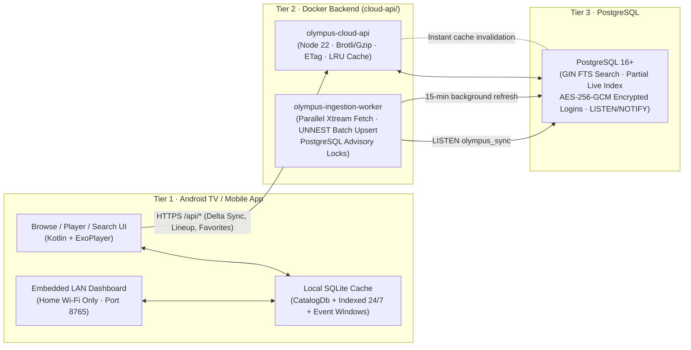

# ClearCast Tuner (Olympus-IPTV)

A high-performance, open-source **Android TV & Mobile IPTV Player** with an embedded **LAN Web Dashboard** and an optional **3-Tier Self-Hosted Cloud Sync Backend** (Docker Node.js API + Background Ingestion Worker + PostgreSQL).

> **Disclaimer:** ClearCast Tuner is a media player and lineup manager only. It does **not** include, host, or provide any playlists, channels, EPG data, or media streams. Users must supply their own legal IPTV / M3U / Xtream Codes sources.

---

## Architecture Overview

ClearCast Tuner works in **two modes**:
1. **Standalone Mode (Zero Backend Required):** Install the Android app, enter your Xtream Codes or M3U playlist, and manage everything locally using the on-device SQLite cache (`CatalogDb`) and the built-in **LAN Web Dashboard** served directly by your TV/phone over home Wi-Fi.
2. **Full 3-Tier Cloud Sync Mode (Optional Self-Hosted Backend):** Deploy `cloud-api/` on any VPS or home server with PostgreSQL so your catalog is ingested in the background, pre-filtered, compressed with Brotli/Gzip, and synced across all your household TVs and phones.



---

## Repository Structure

```text
clearcast-tuner/
├── app/                          # Android TV & Mobile Kotlin application (tv + mobile product flavors)
│   └── src/
│       ├── main/                 # 100% shared engine, embedded LAN dashboard & resources
│       │   ├── assets/dashboard/ # Embedded LAN web dashboard (gzipped at build time into both APKs)
│       │   ├── java/com/olympus/iptv/
│       │   │   ├── data/         # NameStrip live event-window engine & models
│       │   │   ├── playlist/     # CatalogDb (SQLite), DummyEpg, TwentyFourSeven, AdultGroup, Xtream/M3U, Cloud sync
│       │   │   ├── portal/       # Embedded LAN HTTP server (DashboardHost)
│       │   │   └── ui/           # Browse guide, ExoPlayer, Search, DVR, Parental, VPN
│       │   └── res/              # Shared TV & Mobile layouts/resources
│       ├── tv/                   # Set-top box flavor (NVIDIA Shield, Fire TV, Google TV · zero foldable overhead)
│       └── mobile/               # Phone / Foldable / Tablet flavor (SM-F976U unfold watcher & touch overrides)
├── cloud-api/                    # Optional self-hosted Docker backend
│   ├── server.js                 # Express API (Brotli/Gzip, ETag, LRU, GIN search, SSE)
│   ├── dispatch.js               # Multi-provider failover, M3U/XMLTV export, Catch-Up, HDHR, Stream Proxy, DVR rules, Telemetry
│   ├── worker.js                 # Background Xtream + backup-source ingestion worker + advisory locks
│   ├── db.js                     # PostgreSQL pool & encrypted credential store
│   ├── security.js               # AES-256-GCM encryption, SSRF guard, Zod, Pino redaction
│   ├── eventParser.js            # Server-side live event-window parser
│   ├── schema.sql                # Full PostgreSQL schema + performance indexes
│   ├── Dockerfile                # Hardened non-root Node 22 Alpine image
│   ├── docker-compose.yml        # API + Worker (+ optional local-db Postgres & gluetun VPN profiles)
│   └── .env.example              # Safe environment variable template
├── local.properties.example      # Optional Android cloud API URL template
├── CHANGELOG.md                  # Complete version-by-version revision history (0.2.83 → latest)
└── .gitignore                    # Blocks .env, keystores, APKs, local dumps, node_modules
```

---

## Key Features & How Everything Works

### 1. Smart Live Event-Window & Dummy EPG Engine
Sports and PPV IPTV providers often list hundreds of channels like `ESPN+ 16: NO EVENT` or games from yesterday/tomorrow. ClearCast Tuner automatically cleans this up:
- **Inline Date/Time Parsing (`NameStrip.kt` & `DummyEpg.kt`):** Parses ISO dates (`2026-11-25 18:30:00`), ordinal dates (`25th NOV 5PM CET`), `@ Nov 25 7:00PM ET`, international city timezones (`London`, `Paris`, `Berlin`, `Madrid`, `Rome`, `Toronto`, `Sydney`, etc.), and strips region prefixes (`USA |`, `UK :`).
- **Sport-Specific Durations:** Automatically assigns realistic windows (90m press/weigh-ins, 2h high school/NFHS, 2h10m soccer/DAZN/Fanatiz, 2h15m basketball/ESPN+/Disney+, 2h45m default).
- **Strict Visibility Rule:**
  - **NOT LIVE / placeholder slots** (`NO EVENT`, `Off Air`, `No Broadcasting`, `Sendepause`, `Signing Off`, etc.) are **never shown** in the guide, category counts, search, or mini-guide.
  - **Upcoming events** appear **15 minutes before kickoff** (`PRE_EVENT_WINDOW_MS`).
  - **Completed events** remain visible for at most **30 minutes after scheduled end** (`POST_EVENT_GRACE_MS`) for overtime/wrap-up, and are **hard-hidden at exactly 30 minutes** across the guide, Dummy EPG, search, and cloud API.

### 2. Instant Indexed `24/7 Channels`, Unified `Nutflix` Card & Clean Program Guide
- **`24/7 Channels`:** `CatalogDb` indexes `24/7` channels (`idx_channels_247`) with keyset pagination so opening `24/7 Channels` across 200k+ streams is instant without UI freezes, and exempts untagged 24/7 channels from `"__other__"` country hiding while still filtering out foreign-prefixed 24/7 groups when international is off.
- **Unified `Nutflix` (18+) Card:** All 18+/adult live groups automatically merge into a single **`Nutflix`** card (`AdultGroup.kt`, safely excluding `Adult Swim`) that is always pinned as the **last card** in Live TV.
- **Clutter-Free Program Guide:** Program guide cells display clean show titles without duplicate start/end clocks (shown once under the channel name in the left column) and without `"Ending in ..."` or `"Up Next"` title prefixes.
- **Search (`SearchActivity.kt`):** Searches Live TV (active events only), Movies, and TV Shows simultaneously with per-section counts and full TV/Mobile soft-keyboard support.

### 3. Embedded LAN Web Dashboard (No WAN Exposure)
- Runs directly on your TV/Android device over your local Wi-Fi (`DashboardHost.kt`), serving the gzipped **Cinema Obsidian & Molten Gold** web UI (`app/src/main/assets/dashboard/index.html`) for managing countries, groups, channel order, favorites, DVR recordings, reminders, and TV remote control from any phone or laptop on the same network.
- **Multi-Device Management:** View and switch between both your active local TV and offline cloud-synced devices under the same email, edit offline device lineups/favorites directly from the LAN dashboard, or remove stale devices (`POST /api/devices/delete`).
- **Streamlined Layout:** Zero-scroll 4-column Favorites Auto Build, **Live-TV-only** Groups (2-column compact grid with `All Live`, `Sports`, `24/7`, `18+` chips) and Channels (single-line rows with an A–Z Quick Jump strip), and a compact Settings hub that fits cleanly without cutting off bottom cards.
- On the cloud backend (`cloud-api/server.js`), static WAN dashboard hosting is **disabled by default** (`ENABLE_WEB_DASHBOARD=false`) so your VPS only exposes `/api/*` endpoints.

### 4. Dedicated `tv` & `mobile` Flavors, Fire TV & Foldable Performance
- **Separate TV & Mobile APKs, Zero Code Duplication:** Gradle `formFactor` product flavors (`tv` and `mobile`) share 100% of `src/main/` (engine, SQLite, cloud sync, LAN dashboard) while isolating `src/tv/` and `src/mobile/` manifests and `FormFactorBehavior`. `DeviceForm.isTelevision()` / `isTouchPrimary()` resolve at compile time via `BuildConfig.IS_TV_BUILD` / `IS_MOBILE_BUILD`, letting R8 dead-code-strip unused form-factor paths and eliminating startup `PackageManager` IPC calls.
- **Multi-Generation Fire TV Stick & Set-Top Box Support (`tv` flavor):** Supports **NVIDIA Shield**, **Fire OS 6/7/8**, Android TV, and Google TV Streamer (4K) (`minSdk = 24`, `armeabi-v7a` + `arm64-v8a`, GMS-free Cast fallback, zero foldable display-listener overhead, and automatic low-RAM scaling).
- **Foldable & Large-Screen Resilience (`mobile` flavor):** Live `currentWindowMetrics` width checks (no stale 500ms cache) plus a persistent `OnLayoutChangeListener` on `guideShell` automatically re-span and re-bind group/folder grids after hinge unfold/fold, rotation, split-screen, or DeX transitions (e.g., Galaxy Z Fold `SM-F976U`).
- **Zero-Churn Hot Paths:** Cached `NameStrip.statusCache` inspections, deduplicated SQLite live-window & EPG helpers (`CatalogDb`), and pre-compiled regex constants across `ChannelFailover`, `BrowseVodFilter`, `SearchTileAdapter`, and `FreshFragment`/`FreshActivity` keep scrolling and channel zapping snappy even on 1 GB–2 GB sticks.

### 5. Hardened 3-Tier Cloud Sync (`cloud-api/`)
- **Fast Ingestion (`worker.js`):** Fetches all 6 Xtream endpoints in parallel with native Node 22 `fetch` + timeouts/retries, performs **2,500-row** PostgreSQL `UNNEST` bulk upserts across 3 staged commits over persistent TCP keep-alive pools, prunes stale VOD/Series/Categories, and uses **PostgreSQL session advisory locks** (`pg_try_advisory_lock`) so duplicate worker containers never collide.
- **Fast Delivery (`server.js` & `db.js`):**
  - **Zero-DB-RTT Auth Caching:** Caches `ensureAccount` (`accountCache`) and device token hashes (`tokenHashCache`, auto-invalidated on rotation or device deletion) in RAM via `LRUCache`, cutting per-request auth overhead from 2 PostgreSQL round-trips to `< 0.1 ms`.
  - **Low-Memory Non-Blocking Parallel Compression:** Pre-compresses cached catalog snapshots asynchronously in parallel (`Promise.all([gzipAsync, brotliAsync])` on libuv's threadpool) and retains only compressed `br`/`gzip` buffers in RAM (~75% lower cache footprint), skips double-compression on pre-compressed and streaming routes, disables global weak ETag overhead, caches M3U/XMLTV exports for 60s, and serves `ETag` / `304 Not Modified`, `?since=<epochMs>` delta sync, real-time `LISTEN olympus_sync` cache invalidation, and sub-millisecond full-text search via the PostgreSQL GIN index (`idx_cloud_channels_name_fts`).
  - **Proxy-Tuned Keep-Alive & Pool Control:** `httpServer.keepAliveTimeout = 65s` / `headersTimeout = 66s`, configurable `PG_POOL_MAX`, and PostgreSQL TCP keep-alive keep upstream connections warm behind Caddy, Nginx, or Cloudflare.
- **Security by Default:**
  - **AES-256-GCM** encryption at rest for provider passwords & M3U URLs (`CREDENTIALS_KEY`), with automatic startup migration of legacy plaintext rows.
  - **SSRF protection** (`assertSafeProviderUrl`) blocking private/link-local/metadata IPs, plus stream proxy concurrency caps (`MAX_PROXY_RELAYS`, `MAX_CLIENTS_PER_RELAY`).
  - **Zod** request validation, **Pino** structured logging with expanded secret/token redaction, `Cache-Control: no-store` on credential routes, rate limiting, `idle_in_transaction_session_timeout=30000`, non-root Docker user (`USER node`), `cap_drop: [ALL]`, `no-new-privileges:true`, and localhost-only port binding (`127.0.0.1:8443:3000`).

### 6. Advanced Tuner, Failover & Export Features (`cloud-api/dispatch.js` + Android)
- **Multi-Provider Consolidation & Cross-Provider Failover:** Register backup Xtream providers in priority order (`GET/POST /api/providers`, `DELETE /api/providers/:id`). The background worker ingests backup feeds without cluttering the primary guide; if a live channel fails in `PlayerActivity` and no local sibling exists, ClearCast queries `GET /api/channels/:id/alternates` and fails over seamlessly to the matching channel on your backup provider.
- **Filtered M3U & XMLTV Export:** Export your cleaned, lineup-filtered live catalog (respecting hidden groups/channels, custom renames, catch-up tags, and the strict live event window) to any external player via `GET /api/export/playlist.m3u` and `GET /api/export/epg.xml`.
- **Xtream Catch-Up / Archive Parity:** `tv_archive` and `tv_archive_duration` are ingested by the worker, synced through `/api/catalog/sync`, parsed by `LineupClient`, and exposed server-side via `GET /api/catchup/url` alongside direct on-device `CatchupUrls` playback.
- **HDHomeRun Virtual Tuner Emulation (Opt-In):** Enable `ENABLE_HDHR=true` to expose `/discover.json`, `/lineup_status.json`, and `/lineup.json` so **Plex**, **Jellyfin**, and **Emby** can tune your filtered ClearCast lineup as a virtual HDHomeRun tuner.
- **Shared Stream Proxy / Connection Deduplication (Opt-In):** Enable `ENABLE_STREAM_PROXY=true` to fan out a single upstream provider connection across multiple household TVs via `GET /api/proxy/stream/:channelId` (SSRF-guarded, backpressure-safe, and auto-aborts upstream the instant the last viewer disconnects; inspect active relays at `GET /api/proxy/sessions`).
- **Gluetun VPN Sidecar (Opt-In):** Run `docker compose --profile vpn up -d` to launch the optional `qmcgaw/gluetun` WireGuard/VPN sidecar container configured via `.env`.
- **Recurring DVR Series Rules & In-Progress Playback:** Sync rule-based DVR series schedules (`GET/POST/DELETE /api/dvr/rules`, `LineupClient.DvrSeriesRule`) and play in-progress (`RECORDING`) DVR files directly in `PlayerActivity`.
- **Real-Time Stream Health & Telemetry:** `PlayerActivity` reports throttled fire-and-forget playback lock-in, bitrate, and failover failures to `POST /api/telemetry/heartbeat`; query live household sessions and flaky/dead channels at `GET /api/telemetry/summary` (auto-pruned after 7 days).

---

## Option A: Standalone Android App Quickstart (No Server Needed)

1. **Clone the repository:**
   ```bash
   git clone https://github.com/<your-username>/ClearCast-Tuner.git
   cd ClearCast-Tuner/clearcast-tuner
   ```
2. **Open in Android Studio** (JDK 17 / Android Studio JBR, pick `tvRelease` or `mobileRelease` in **Build Variants**) or build from the command line:
   ```powershell
   # Windows PowerShell (verify both flavors: unit tests + release Kotlin compile)
   $env:JAVA_HOME = "C:\Program Files\Android\Android Studio\jbr"
   .\gradlew.bat :app:gzipDashboardHtml :app:testTvDebugUnitTest :app:testMobileDebugUnitTest :app:compileTvReleaseKotlin :app:compileMobileReleaseKotlin
   ```
3. **Build Release APKs** (auto-copied to `Downloads` as `olympus-iptv-tv-<ver>.apk` and `olympus-iptv-mobile-<ver>.apk`):
   ```powershell
   # Build both TV and Mobile APKs
   .\gradlew.bat :app:assembleRelease
   # Or build just one flavor:
   .\gradlew.bat :app:assembleTvRelease
   .\gradlew.bat :app:assembleMobileRelease
   ```
4. **Add your playlist** directly on the TV/phone, or open the **LAN Dashboard URL** shown on screen from any browser on your home Wi-Fi.

---

## Option B: Self-Hosting the Full 3-Tier Cloud Stack (`cloud-api/`)

### Step 1 — Configure Environment Variables
```bash
cd clearcast-tuner/cloud-api
cp .env.example .env
```
Generate strong secrets and put them in `.env` (**never commit `.env`**):
```bash
# 32-byte AES-256-GCM encryption key for provider credentials at rest
openssl rand -hex 32   # -> paste into CREDENTIALS_KEY

# Optional shared API key for X-Olympus-Api-Key header
openssl rand -hex 32   # -> paste into API_SECRET_KEY
```

### Step 2 — Choose Your PostgreSQL Setup

#### Path 2A: External Managed PostgreSQL (CloudClusters, Neon, Supabase, RDS, etc.)
1. Set `PGHOST`, `PGPORT`, `PGDATABASE`, `PGUSER`, `PGPASSWORD`, and `PGSSLMODE=require` (or `DATABASE_URL`) in `cloud-api/.env`.
2. Initialize the database schema once:
   ```bash
   psql "$DATABASE_URL" -f schema.sql
   ```
3. Start the API + Ingestion Worker containers:
   ```bash
   docker compose up -d --build
   ```

#### Path 2B: All-in-One Local Docker PostgreSQL (Single Command)
1. In `cloud-api/.env`, set:
   ```env
   PGHOST=postgres
   PGPORT=5432
   PGDATABASE=clearcast_iptv
   PGUSER=postgres
   PGPASSWORD=choose_a_strong_password
   PGSSLMODE=disable
   ```
2. Start PostgreSQL (auto-loads `schema.sql`), the API, and the Worker together:
   ```bash
   docker compose --profile local-db up -d --build
   ```

### Step 3 — Verify Health & Put Behind HTTPS (Reverse Proxy)
The API binds to `127.0.0.1:8443` by default so it is never exposed raw without TLS:
```bash
curl http://127.0.0.1:8443/api/health
```
Point **Caddy**, **Nginx**, or **Cloudflare Tunnel** at `http://127.0.0.1:8443` for automatic HTTPS. Example Caddyfile:
```caddyfile
api.yourdomain.com {
    reverse_proxy 127.0.0.1:8443
}
```

### Step 4 — Connect the Android App to Your Cloud API
1. Copy `local.properties.example` settings into your local (gitignored) `clearcast-tuner/local.properties`:
   ```properties
   portal.cloudUrl=https://api.yourdomain.com
   ```
2. Rebuild the app. When you log in on any TV or phone, it automatically registers the playlist in PostgreSQL (`POST /api/setup`), triggers immediate ingestion via `NOTIFY olympus_sync`, and syncs lineups, favorites, and filtered live catalogs across all your devices.

---

## Keeping Your Fork & Secrets Safe

- **Never commit** `.env`, `local.properties`, `*.jks`, `*.keystore`, `*.pem`, `*.key`, `cloud-api/data/`, or `cloud-api/certs/` — all of these are blocked by `.gitignore`.
- Rotate `CREDENTIALS_KEY` and `PGPASSWORD` before exposing any server to the internet.
- Keep `BIND_HOST=127.0.0.1` and `ENABLE_WEB_DASHBOARD=false` unless you intentionally configure TLS + authentication in front of your server.
- Enable **GitHub Secret Scanning & Push Protection** in your repository settings before pushing.

---

## Revision History & Changelog

For the complete version-by-version release notes (**0.2.83 through latest**), see [**`CHANGELOG.md`**](./CHANGELOG.md).

| Version | Highlights |
| --- | --- |
| **Unreleased (Post-0.2.142)** | Monorepo Docker `cloud-api/` backend (low-memory Brotli/Gzip, GIN FTS, 60s export cache, proxy relay caps, instant token revocation, advisory locks, AES-256-GCM, optional `local-db` Postgres & `gluetun` VPN profiles), multi-provider failover, M3U/XMLTV export, Xtream catch-up parity, opt-in HDHomeRun tuner & shared stream proxy, DVR series rules, stream health telemetry, strict 15m pre / 30m post-event hard cutoff & Dummy EPG parity, cleaner TV guide cells, `24/7 Channels` country-filter fix, unified `Nutflix` (18+) last card, multi-device offline editing & deletion, Live-only Groups/Channels & compact Settings LAN UI, D-Pad focus fixes, and Fire TV hot-path optimizations |
| **[0.2.142](./CHANGELOG.md#whats-in-02142)** | Unified `24/7 Channels` group, live event & guide sync (`ESPN+` / `Disney+` / PPV), split channel/group sanitization, TV EPG Edits & Web-UI Access layout polish |
| **[0.2.137](./CHANGELOG.md#whats-in-02137)** | Local major networks (`FOX`/`ABC`/`CBS`/`NBC`/`PBS`) with offline ZIP fallback, self-healing group names, revamped Web-UI Settings & EPG tools, API key auth |
| **[0.2.132](./CHANGELOG.md#whats-in-02132)** | Mobile Live TV guide row alignment & scroll lock, pinch-to-zoom & 2× long-press gestures, Google Drive & OneDrive DVR cloud upload |
| **[0.2.127 – 0.2.83](./CHANGELOG.md#whats-in-02127)** | Pro Features & Household Profiles, universal Android 7–16 / Fire OS / Google TV Streamer (4K) support, cloud sync, title pages, and DVR/Reminders foundation |

---

## License

Open-source for personal and educational use. Feel free to fork, customize, and self-host your own instance.
